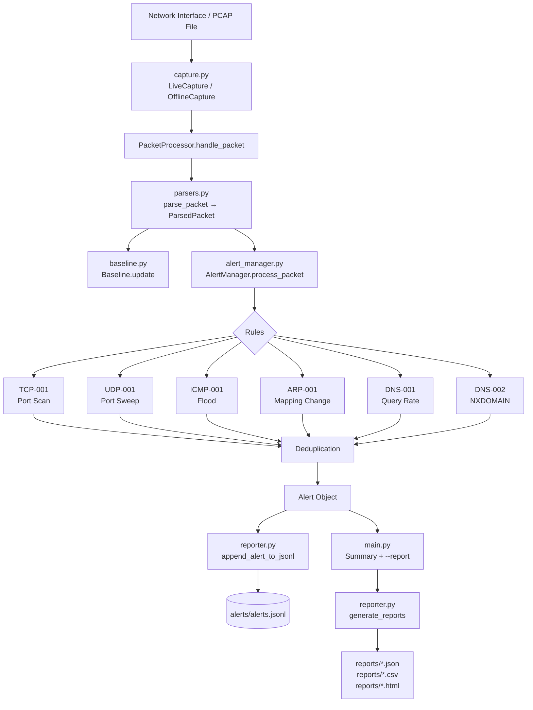

# 🛡 NetSentinel

**Real-Time Network Threat Detection and Anomaly Monitoring System**

A lightweight, modular Network Intrusion Detection System (NIDS) written in Python.  
NetSentinel passively captures network packets, applies configurable detection rules, and produces evidence-based security reports — without requiring a commercial framework, database server, or internet connection.

---

## Table of Contents

1. [Project Overview](#1-project-overview)
2. [Problem Statement](#2-problem-statement)
3. [Goals and Non-Goals](#3-goals-and-non-goals)
4. [Key Features](#4-key-features)
5. [Supported Protocols](#5-supported-protocols)
6. [Architecture and Module Responsibilities](#6-architecture-and-module-responsibilities)
7. [Architecture Diagram](#7-architecture-diagram)
8. [Prerequisites](#8-prerequisites)
9. [Installation — Linux (Ubuntu / Kali)](#9-installation--linux-ubuntu--kali)
10. [Virtual Environment Setup](#10-virtual-environment-setup)
11. [Dependency Installation](#11-dependency-installation)
12. [Live-Capture Permissions and Interface Selection](#12-live-capture-permissions-and-interface-selection)
13. [Offline PCAP Analysis](#13-offline-pcap-analysis)
14. [Configuration Guide](#14-configuration-guide)
15. [Detection Rules](#15-detection-rules)
16. [Example Alerts and Reports](#16-example-alerts-and-reports)
17. [Running the Test Suite](#17-running-the-test-suite)
18. [Troubleshooting](#18-troubleshooting)
19. [Known Limitations and False-Positive Scenarios](#19-known-limitations-and-false-positive-scenarios)
20. [Ethical and Authorized-Use Statement](#20-ethical-and-authorized-use-statement)
21. [Future Improvements](#21-future-improvements)
22. [GitHub Repository Setup](#22-github-repository-setup)
23. [Demonstration Script](#23-demonstration-script)
24. [Resume-Ready Project Description](#24-resume-ready-project-description)

---

## 1. Project Overview

NetSentinel monitors TCP, UDP, ICMP, ARP, and DNS traffic on an authorized network interface or a saved PCAP file.  It applies six configurable threshold-based detection rules, maintains a behavioral baseline for comparison, and writes structured alerts with supporting evidence.  Reports are exported as JSON, CSV, and HTML.

---

## 2. Problem Statement

Security Operations Center (SOC) analysts and students need a practical tool to observe network behavior, recognize suspicious patterns, and produce defensible evidence without relying on commercial products.  Existing lightweight tools are either too narrow (single-protocol) or require heavyweight dependencies.

---

## 3. Goals and Non-Goals

**Goals**
- Demonstrate real defensive security engineering skills with Python and Scapy.
- Apply configurable detection rules to multiple protocols.
- Produce structured, machine-readable alerts with evidence.
- Generate professional reports openable in a browser.
- Provide a comprehensive automated test suite that runs without root access.
- Serve as a portfolio project for SOC Analyst or Defensive Security internship applications.

**Non-Goals**
- Active scanning or packet injection.
- Deep-packet inspection of encrypted traffic.
- Machine learning or statistical anomaly detection beyond simple thresholds.
- Web-based UI or real-time dashboard.
- Production-grade deployment (no database, authentication, or scalability design).

---

## 4. Key Features

- Passive packet capture via Scapy on any authorized interface.
- Offline PCAP analysis without elevated privileges (file-permission dependent).
- Six detection rules covering TCP, UDP, ICMP, ARP, and DNS.
- Configurable thresholds, time windows, and exclusion lists.
- Lightweight behavioral baseline with JSON persistence.
- Alert deduplication with configurable suppression window.
- JSON (JSONL), CSV, and HTML report generation.
- HTML output with safe escaping of all untrusted values.
- Bounded in-memory state — no unbounded memory growth.
- Graceful Ctrl+C shutdown.
- Full unittest suite (no live network or root access required).

---

## 5. Supported Protocols

| Layer | Protocols |
|-------|-----------|
| Layer 2 | Ethernet, ARP |
| Layer 3 | IPv4 |
| Layer 4 | TCP, UDP, ICMP |
| Application | DNS (over UDP/TCP port 53) |

IPv6 is not currently parsed but will not crash the system.

---

## 6. Architecture and Module Responsibilities

| Module | Responsibility |
|--------|---------------|
| `main.py` | CLI entry point, argument validation, module wiring, summary output |
| `capture.py` | Live interface capture and offline PCAP reading via Scapy; packet statistics |
| `parsers.py` | Safe protocol parsing → normalized `ParsedPacket` dataclass |
| `config_loader.py` | Load, validate, and return a typed `Config` dataclass from `config.json` |
| `alert_manager.py` | Six detection rule classes; `AlertManager` orchestration, deduplication, `Alert` dataclass |
| `baseline.py` | Learning-phase accumulation, JSON persistence, and baseline comparison |
| `reporter.py` | JSON, CSV, and HTML report generation; JSONL alert persistence |
| `utils.py` | UTC timestamps, UUID generation, MAC/IP normalization, HTML escaping, safe JSON |

---

## 7. Architecture Diagram



---

## 8. Prerequisites

- Python 3.11 or newer
- pip
- libpcap (Linux/macOS) or Npcap (Windows) for live capture
- A network interface you are authorized to monitor

---

## 9. Installation — Linux (Ubuntu / Kali)

```bash
# 1. Install system dependencies
sudo apt-get update
sudo apt-get install python3 python3-pip python3-venv python3-dev libpcap-dev git

# 2. Clone the repository
git clone https://github.com/YOUR_USERNAME/NetSentinel.git
cd NetSentinel

# 3. Create and activate a virtual environment
python3 -m venv venv
source venv/bin/activate

# 4. Install Python dependencies
pip install -r requirements.txt

# 5. Verify installation
python main.py --help
```

---

## 10. Virtual Environment Setup

```bash
# Create
python3 -m venv venv

# Activate (Linux/macOS)
source venv/bin/activate

# Activate (Windows PowerShell)
.\venv\Scripts\Activate.ps1

# Deactivate when done
deactivate
```

---

## 11. Dependency Installation

```bash
pip install -r requirements.txt

# Verify Scapy
python -c "import scapy; print('Scapy', scapy.__version__)"
```

---

## 12. Live-Capture Permissions and Interface Selection

Live capture requires read access to the raw socket or BPF device.

**Option A — Run with sudo (simplest for a lab)**
```bash
sudo python main.py --interface eth0
```

**Option B — Grant CAP_NET_RAW to the Python interpreter (Linux only)**
```bash
sudo setcap cap_net_raw,cap_net_admin+eip $(which python3)
python main.py --interface eth0
```

**List available interfaces:**
```bash
python main.py --list-interfaces
# or with sudo if the list is empty:
sudo python main.py --list-interfaces
```

**Common interface names:** `eth0`, `ens33`, `wlan0`, `lo` (loopback), `any` (Linux all-interfaces).

---

## 13. Offline PCAP Analysis

Offline analysis is the recommended method for testing and for sharing captures in a lab.

```bash
# Analyse a PCAP file and generate reports
python main.py --offline captures/lab.pcap --report

# Analyse without generating reports
python main.py --offline captures/lab.pcap
```

You can create a test PCAP with `tcpdump`:
```bash
sudo tcpdump -i eth0 -w captures/lab.pcap -G 60 -W 1
```

Or with Scapy:
```python
from scapy.all import *
wrpcap("test.pcap", [
    Ether()/IP(src="10.0.0.1",dst="10.0.0.2")/TCP(dport=80,flags="S"),
])
```

---

## 14. Configuration Guide

All settings live in `config.json`.  Every key used in the code is documented below.  Units are shown in brackets.

### TCP (`tcp`)
| Key | Type | Default | Description |
|-----|------|---------|-------------|
| `enabled` | bool | `true` | Enable TCP-001 rule |
| `syn_port_threshold` | int | `20` | Distinct destination ports in the window before alerting |
| `observation_window_seconds` | int [s] | `60` | Sliding window duration |
| `excluded_sources` | list of IP strings | `[]` | Source IPs that are never alerted on |

### UDP (`udp`)
| Key | Type | Default | Description |
|-----|------|---------|-------------|
| `enabled` | bool | `true` | Enable UDP-001 rule |
| `port_diversity_threshold` | int | `15` | Distinct UDP destination ports before alerting |
| `observation_window_seconds` | int [s] | `60` | Sliding window duration |
| `excluded_sources` | list | `[]` | Excluded source IPs |

### ICMP (`icmp`)
| Key | Type | Default | Description |
|-----|------|---------|-------------|
| `enabled` | bool | `true` | Enable ICMP-001 rule |
| `echo_request_threshold` | int | `50` | Echo requests per source per window |
| `observation_window_seconds` | int [s] | `30` | Sliding window duration |
| `excluded_sources` | list | `[]` | Excluded source IPs |

### ARP (`arp`)
| Key | Type | Default | Description |
|-----|------|---------|-------------|
| `enabled` | bool | `true` | Enable ARP-001 rule |
| `mapping_expiry_seconds` | int [s] | `300` | Time before an unseen IP→MAC entry is expired |
| `trusted_mappings` | dict {ip: mac} | `{}` | Known-good IP→MAC pairs, never alerted on |
| `max_table_size` | int | `1024` | Maximum IP→MAC entries held in memory |

### DNS (`dns`)
| Key | Type | Default | Description |
|-----|------|---------|-------------|
| `enabled` | bool | `true` | Enable DNS-001 and DNS-002 rules |
| `query_rate_threshold` | int | `100` | DNS queries per source per window (DNS-001) |
| `observation_window_seconds` | int [s] | `60` | Window for DNS-001 |
| `nxdomain_threshold` | int | `20` | NXDOMAIN responses per querier per window (DNS-002) |
| `nxdomain_window_seconds` | int [s] | `60` | Window for DNS-002 |
| `excluded_sources` | list | `[]` | Excluded source IPs |

### Baseline (`baseline`)
| Key | Type | Default | Description |
|-----|------|---------|-------------|
| `enabled` | bool | `true` | Enable baseline tracking |
| `learning_duration_seconds` | int [s] | `300` | How long the learning phase lasts |
| `baseline_file` | string (path) | `"data/baseline.json"` | Where to store the baseline snapshot |
| `anomaly_multiplier` | float | `2.0` | Alert if live value > baseline × this multiplier |

### Output (`output`)
| Key | Type | Default | Description |
|-----|------|---------|-------------|
| `alerts_dir` | string (path) | `"alerts"` | Directory for JSONL alert log |
| `reports_dir` | string (path) | `"reports"` | Directory for generated reports |
| `logs_dir` | string (path) | `"logs"` | Directory for operational logs |
| `data_dir` | string (path) | `"data"` | Directory for baseline and misc data |
| `max_alerts_in_memory` | int | `10000` | Maximum alerts held in RAM |
| `alert_suppression_window_seconds` | int [s] | `60` | Minimum seconds between repeated alerts for the same rule+source |
| `generate_report_on_exit` | bool | `true` | Auto-generate reports when --report is passed |

### Logging (`logging`)
| Key | Type | Default | Description |
|-----|------|---------|-------------|
| `level` | string | `"INFO"` | Log verbosity: DEBUG, INFO, WARNING, ERROR |
| `log_to_file` | bool | `true` | Write operational log to file |
| `log_filename` | string (path) | `"logs/netsentinel.log"` | Log file path |

### Optional: `local_networks`
A JSON array of CIDR strings (e.g. `["192.168.1.0/24"]`).  Currently reserved for scope restriction; an empty array means all traffic is processed.

---

## 15. Detection Rules

### TCP-001 — Possible TCP Port Scan
**Trigger:** A source IP sends SYN packets (no ACK) to ≥ `syn_port_threshold` distinct destination ports within `observation_window_seconds`.  
**Evidence:** Distinct port count, threshold, sampled port list, observation window.  
**Caution:** Network scanners, vulnerability assessment tools, and CI/CD pipelines legitimately contact many ports.  Verify authorization before escalating.

### UDP-001 — Possible UDP Port Sweep
**Trigger:** A source IP sends UDP to ≥ `port_diversity_threshold` distinct destination ports within the window.  
**Evidence:** Distinct port count, threshold, sampled port list.  
**Caution:** mDNS, SSDP, and discovery protocols contact many ports; verify context.

### ICMP-001 — Possible ICMP Sweep / Flood
**Trigger:** A source IP sends ≥ `echo_request_threshold` ICMP echo requests (type 8 only) within `observation_window_seconds`.  
**Evidence:** Request count, threshold, observation window.  
**Caution:** Network troubleshooting (`ping` sweeps) is a common legitimate source of false positives.

### ARP-001 — Possible ARP Spoofing / Mapping Change
**Trigger:** A new MAC address is observed for an IP address that was previously mapped to a different MAC.  
**Evidence:** Previous MAC, new MAC, IP address.  
**Caution:** DHCP renewals, NIC replacements, failover, and virtualization environments regularly produce legitimate MAC changes.  Trusted mappings (config) are never alerted on.  Stale entries expire after `mapping_expiry_seconds`.

### DNS-001 — Possible DNS Query Rate Anomaly
**Trigger:** A source IP sends ≥ `query_rate_threshold` DNS queries (qr=0 only) within `observation_window_seconds`.  
**Evidence:** Query count, threshold, last observed query name.  
**Caution:** DNS caching misconfigurations and misbehaving applications can generate high query rates legitimately.

### DNS-002 — Possible Excessive NXDOMAIN Responses
**Trigger:** A host receives ≥ `nxdomain_threshold` NXDOMAIN (rcode=3) DNS responses within `nxdomain_window_seconds`.  
**Evidence:** NXDOMAIN count, threshold, queried name (if available).  
**Caution:** A high NXDOMAIN rate is a weak indicator; it does not confirm malware or DGA activity.  Correlate with other indicators before concluding.

---

## 16. Example Alerts and Reports

```json
{
  "alert_id": "b3e2a1f09c4d4b8e8f9a1b2c3d4e5f60",
  "timestamp_utc": "2024-05-01T14:32:05.123Z",
  "rule_id": "TCP-001",
  "rule_name": "Possible TCP Port Scan",
  "severity": "medium",
  "source_ip": "192.168.1.42",
  "destination_ip": "192.168.1.1",
  "protocol": "TCP",
  "description": "Source 192.168.1.42 contacted 23 distinct TCP destination ports in 60s (threshold: 20). Possible port scan.",
  "evidence": {
    "rule_id": "TCP-001",
    "source_ip": "192.168.1.42",
    "distinct_dst_ports": 23,
    "threshold": 20,
    "observation_window_seconds": 60,
    "sampled_ports": [21, 22, 23, 25, 53, 80, 110, 143, 443, 445]
  },
  "recommended_action": "Investigate the source host...",
  "confidence": "medium"
}
```

Reports are written to `reports/` as:
- `netsentinel_report_YYYYMMDD_HHMMSS.json`
- `netsentinel_report_YYYYMMDD_HHMMSS.csv`
- `netsentinel_report_YYYYMMDD_HHMMSS.html`

Open the HTML report in any browser.

---

## 17. Running the Test Suite

```bash
# From the project root with the virtualenv activated
python -m unittest discover -s tests -v

# Or run individual test modules
python -m unittest tests.test_parsers -v
python -m unittest tests.test_tcp_detection -v
python -m unittest tests.test_arp_detection -v
python -m unittest tests.test_reporter -v
```

All tests run without:
- A live network connection.
- Root / administrator privileges.
- Any external network access.

---

## 18. Troubleshooting

| Problem | Likely cause | Solution |
|---------|-------------|---------|
| `PermissionError` on live capture | Missing raw-socket privileges | Use `sudo` or grant `CAP_NET_RAW` |
| `No such device` interface error | Wrong interface name | Run `--list-interfaces` |
| `Scapy not installed` | Missing dependency | `pip install scapy` |
| Empty interface list | Scapy needs privileges to enumerate | Run `sudo python main.py --list-interfaces` |
| `ConfigError: required section missing` | `config.json` is malformed | Restore from the template in the repo |
| No alerts generated | Thresholds too high for test traffic | Lower thresholds in `config.json` for lab testing |
| HTML report shows escaped tags | Intentional — untrusted values are escaped | This is correct security behaviour |
| Tests fail with import errors | Wrong working directory | Run from the project root |

---

## 19. Known Limitations and False-Positive Scenarios

- **Passive visibility only:** NetSentinel sees only packets that reach the capture interface.  On switched networks, this is typically only traffic to/from the capture host, unless port mirroring is configured.
- **Encrypted traffic:** Payload content of TLS/HTTPS or other encrypted streams is not inspected.  Only observable metadata (IPs, ports, packet sizes, DNS names) is analysed.
- **Packet loss:** Under high load, the OS or capture driver may drop packets.
- **Hardware offloading:** TCP segmentation offload (TSO) and large receive offload (LRO) may cause packets to appear larger than the MTU or to not appear individually.
- **ARP false positives:** DHCP lease renewals, NIC replacement, virtual machine migration, and link aggregation all produce legitimate MAC address changes.
- **ICMP false positives:** Network diagnostic tools (`ping`, `traceroute`), monitoring systems, and network management software generate high ICMP rates.
- **DNS false positives:** DNS resolver misconfiguration, caching failures, and some CDN implementations generate high query rates and NXDOMAIN rates.
- **No IPv6 support:** IPv6 packets are not parsed; only IPv4 is currently supported.
- **Single-threaded detection:** Rule processing occurs in the Scapy capture callback; under very high packet rates, some packets may be processed late or skipped.
- **Clock accuracy:** Sliding windows depend on system time; NTP jumps or time adjustments can affect window boundaries.

---

## 20. Ethical and Authorized-Use Statement

**This tool must only be used on networks you own or have explicit written authorization to monitor.**

Passive packet capture — even without injecting traffic — may be illegal in your jurisdiction without network owner consent.

NetSentinel is designed for:
- Your own home lab.
- A corporate or institutional network where you hold written authorization from the network owner.
- A controlled academic or CTF environment with explicit permission.

Do not use this tool on public networks, shared infrastructure, or any network without written permission.  The authors and contributors accept no liability for misuse.

---

## 21. Future Improvements

- IPv6 parsing support.
- Rate-limited console alert display.
- PCAP export of packets that triggered alerts (selectively, with privacy consideration).
- Multi-interface capture support.
- Alert correlation across rules.
- Configurable alert output to syslog or a SIEM endpoint.
- HTTPS/TLS certificate metadata extraction (for JA3 fingerprinting).
- Streaming JSONL report mode for long-running captures.
- Docker container for reproducible deployment in lab environments.

---

## 22. GitHub Repository Setup

```bash
# Initialize the repository
cd NetSentinel
git init
git add .
git commit -m "feat: initial NetSentinel implementation

- Passive NIDS with six detection rules (TCP-001, UDP-001, ICMP-001,
  ARP-001, DNS-001, DNS-002)
- Configurable thresholds, time windows, and exclusion lists
- Behavioral baseline with JSON persistence
- JSON, CSV, and HTML reporting with safe HTML escaping
- Full unittest suite (no root access or live network required)
- Offline PCAP analysis support
- Comprehensive documentation and ethical use statement"

# Connect to GitHub (replace with your actual username and repo)
git remote add origin https://github.com/YOUR_USERNAME/NetSentinel.git
git branch -M main
git push -u origin main

# Check status
git status
git log --oneline
```

---

## 23. Demonstration Script (2–3 minutes)

**Setup (before the demo):**
```bash
source venv/bin/activate
python -m unittest discover -s tests -q  # All tests pass
```

**Script:**

1. **(30 s) Show the help and config:**
   ```bash
   python main.py --help
   python main.py --show-config
   ```

2. **(30 s) Run offline PCAP analysis:**
   ```bash
   python main.py --offline captures/test.pcap --report
   ```
   Explain: "I'm feeding a pre-captured PCAP file through all six detection rules.  No root access needed for offline mode."

3. **(30 s) Highlight a TCP-001 alert:**
   Open the JSON report.  Point to the `evidence` dict.  "This is what separates a NIDS from a simple firewall log — we capture why the rule fired and what the analyst should do next."

4. **(30 s) Show the HTML report:**
   Open `reports/netsentinel_report_*.html` in a browser.  "The report escapes all untrusted values to prevent HTML injection — a common oversight in student projects."

5. **(30 s) Explain a design decision:**
   "Alert deduplication prevents a single scan from generating thousands of identical alerts and overwhelming the analyst.  The suppression window is configurable — in a lab I set it to 30 seconds; in production you might use 5 minutes."

---

## 24. Resume-Ready Project Description

**NetSentinel — Python Network Intrusion Detection System**  
*Python 3.11 · Scapy · Standard Library · unittest*

Designed and implemented a modular, passive Network Intrusion Detection System in Python.  The system captures packets on authorized interfaces or from PCAP files, applies six configurable rule-based detection algorithms (port scan detection, UDP sweep detection, ICMP flood detection, ARP spoofing detection, DNS query rate anomaly, and NXDOMAIN rate detection), and generates structured evidence-based alerts.  Key engineering decisions include: bounded sliding time windows using `collections.deque` to prevent unbounded memory growth; injectable time functions to enable deterministic unit testing without real-time delays; safe HTML escaping to prevent report injection; alert deduplication with a configurable suppression window; and a behavioral baseline system with JSON persistence.  Delivered full automated test coverage (22+ test cases) requiring no root access or live network connection.
