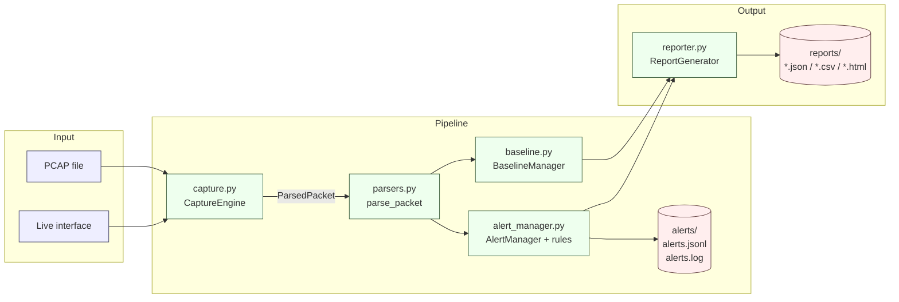

# NetSentinel

**Real-Time Network Threat Detection and Anomaly Monitoring System**

A lightweight, defensive Network Intrusion Detection System (NIDS) written in
Python. NetSentinel captures packets on an authorised interface (or replays a
PCAP file), extracts protocol metadata, applies configurable detection rules,
records evidence-backed alerts and produces JSON, CSV and HTML reports.

> **Defensive tool only.** NetSentinel never transmits crafted packets, never
> scans remote targets and contains no stealth or evasion features. Only run
> it on networks you own or have explicit written authorisation to monitor.

---

## 1. Project overview

NetSentinel is a small, readable NIDS built for a cybersecurity portfolio and
lab demonstrations. It is designed to be explainable: every alert carries the
raw measured values that triggered it, and every detection rule is a short,
independently testable class.

The project deliberately avoids machine learning, database servers, web
frontends and heavy frameworks. Scapy is the only external dependency.

## 2. Problem statement

A security analyst needs a way to see what is happening on a small network
*now* — who is talking to whom, using which protocols, and whether any
pattern resembles known intrusion behaviour (port scans, ICMP floods, ARP
spoofing, DNS anomalies). Commercial tools are heavy to deploy and their
reasoning is opaque. NetSentinel gives the analyst a small, transparent
pipeline whose decisions can be reproduced from raw packet metadata.

## 3. Goals and non-goals

**Goals**

* Capture and dissect TCP, UDP, ICMP, ARP and DNS traffic.
* Apply six configurable, evidence-producing detection rules.
* Provide a lightweight behavioural baseline.
* Produce machine-readable and human-readable reports.
* Be safe to run on a lab network with a single command.
* Be testable without live capture or elevated privileges.

**Non-goals**

* Deep packet inspection of encrypted payloads.
* Blocking, quarantining or altering traffic (this is a monitor, not an IPS).
* Detecting every known attack or acting as a full IDS replacement.
* Replacing commercial SIEM or EDR platforms.
* Machine learning, heuristic scoring or anomaly scoring beyond documented
  thresholds.

## 4. Key features

* Live capture on an explicitly selected interface.
* Offline PCAP replay (no privileges required).
* Six detection rules with configurable thresholds and time windows.
* Evidence dictionary attached to every alert.
* Deduplication of repeated alerts within a configurable suppression window.
* Bounded in-memory state (LRU, `deque(maxlen)`) so long runs cannot leak.
* JSON, CSV and HTML report generation with HTML escaping.
* Transparent baseline built from per-protocol and per-host counts.
* Structured operational log separate from security alerts.
* Graceful Ctrl+C handling with a session summary.

## 5. Supported protocols

| Layer    | Protocol | What NetSentinel extracts                                     |
|----------|----------|----------------------------------------------------------------|
| L2       | Ethernet | Source and destination MAC addresses                           |
| L2       | ARP      | Operation, sender/target IP, sender/target MAC                 |
| L3       | IPv4     | Source/destination IP, protocol number, TTL                    |
| L4       | TCP      | Source/destination port, flags (S/A/F/R/P/U/E/C)               |
| L4       | UDP      | Source/destination port                                        |
| L3       | ICMP     | Type, code                                                     |
| L7       | DNS      | Query vs. response, query name, query type, response code      |

Encrypted payloads (TLS, SSH, VPN) are visible only as their observable
metadata (addresses, ports, timing, packet sizes, flags).

## 6. Architecture and module responsibilities

| File                | Responsibility                                                    |
|---------------------|-------------------------------------------------------------------|
| `main.py`           | CLI parsing, orchestration, exit codes, session summary           |
| `capture.py`        | Live capture and offline PCAP replay; per-session counters        |
| `parsers.py`        | Safe protocol dissection into a `ParsedPacket` dataclass          |
| `config_loader.py`  | Load and validate `config.json`; reject invalid settings          |
| `alert_manager.py`  | Six detection rules, deduplication, alert persistence             |
| `baseline.py`       | Protocol/host counts, JSON baseline, comparison                   |
| `reporter.py`       | JSON, CSV and HTML report generation                              |
| `utils.py`          | Time, address normalisation, identifiers, atomic file writes      |
| `tests/`            | `unittest` suite that never opens a socket                        |

## 7. Architecture diagram



## 8. Prerequisites

* Python **3.11 or newer**
* `pip`
* Linux (tested conceptually against Ubuntu 22.04+/Kali; other POSIX systems
  should work with equivalent privilege setup)
* For **live** capture only:
  * Root or the `CAP_NET_RAW` capability
  * `libpcap` (usually installed by default on desktop Linux; on minimal
    images, install `libpcap0.8` via your package manager)

Offline analysis of a PCAP file needs **none of the capture privileges**.

## 9. Installation (Ubuntu / Kali)

```bash
# System packages (only needed for live capture)
sudo apt update
sudo apt install -y python3 python3-venv python3-pip libpcap0.8 tcpdump

# Grab the code
git clone https://github.com/<your-username>/NetSentinel.git
cd NetSentinel
```

## 10. Virtual environment setup

```bash
python3 -m venv .venv
source .venv/bin/activate
python -m pip install --upgrade pip
```

## 11. Dependency installation

```bash
pip install -r requirements.txt
python -c "import scapy; print(scapy.__version__)"
```

The only runtime dependency is Scapy (`>=2.5.0,<2.7`). If installation fails
on your platform, pin to a version you have verified locally and record the
change in your fork's README.

## 12. Live-capture permissions and interface selection

Live capture normally needs the ability to put an interface into promiscuous
mode. Two options:

**Option A — run as root (simplest for a lab)**

```bash
sudo -E .venv/bin/python main.py --interface eth0 --duration 60 --report
```

**Option B — grant the capability to the interpreter (safer)**

```bash
sudo setcap cap_net_raw,cap_net_admin=eip $(readlink -f .venv/bin/python)
.venv/bin/python main.py --interface eth0 --duration 60 --report
```

List the interfaces visible to this process:

```bash
python main.py --list-interfaces
```

Always pass an explicit `--interface`. NetSentinel will refuse to run without
one, and will refuse an interface that does not exist.

## 13. Offline PCAP analysis

Offline analysis works with no privileges and no live traffic:

```bash
python main.py --offline samples/demo.pcap --report
```

A short synthetic capture is easy to make with `tcpdump`:

```bash
sudo tcpdump -i eth0 -w demo.pcap -c 500
```

…then hand `demo.pcap` to NetSentinel from a normal user account.

## 14. Configuration guide

Every tunable lives in `config.json`. Sections:

| Section         | Purpose                                                         |
|-----------------|-----------------------------------------------------------------|
| `log_level`     | `DEBUG`/`INFO`/`WARNING`/`ERROR`/`CRITICAL`                     |
| `output_dirs`   | Where alerts, reports, logs and baseline data are written       |
| `retention`     | `max_in_memory_alerts` — bounds the alert deque                 |
| `deduplication` | `suppression_window_seconds` — how long an identical alert is suppressed |
| `network_scope` | Optional CIDR allowlist; if disabled, nothing is filtered       |
| `severity`      | Per-rule severity label (`low`/`medium`/`high`/`critical`)      |
| `trusted_hosts` | Source IPs that will not trigger rules                          |
| `detection`     | Per-protocol thresholds and windows (see below)                 |
| `baseline`      | Learning mode, observation window, baseline file path           |

### Detection section, key by key

**`detection.tcp`**

| Key                          | Units     | Meaning                                                     |
|------------------------------|-----------|-------------------------------------------------------------|
| `enabled`                    | bool      | Turn the TCP-001 rule on or off                             |
| `window_seconds`             | seconds   | Sliding observation window                                  |
| `distinct_destination_ports` | count     | Minimum distinct destination ports to trigger               |
| `excluded_destination_ports` | ports     | Ports that are ignored (e.g. `[80, 443]` for a web server)  |
| `max_tracked_sources`        | count     | LRU cap on simultaneously tracked source IPs                |

**`detection.udp`** — same shape as TCP but without exclusions.

**`detection.icmp`**

| Key               | Units   | Meaning                                       |
|-------------------|---------|-----------------------------------------------|
| `window_seconds`  | seconds | Sliding window                                |
| `echo_requests`   | count   | Echo requests required to trigger ICMP-001    |

**`detection.arp`**

| Key                  | Units   | Meaning                                                |
|----------------------|---------|--------------------------------------------------------|
| `mapping_ttl_seconds`| seconds | How long a mapping is remembered before it is stale    |
| `max_tracked_mappings` | count | LRU cap on the mapping table                           |
| `trusted_mappings`   | object  | `{"10.0.0.1": "aa:bb:cc:dd:ee:ff"}` — known static hosts |

**`detection.dns`**

| Key                      | Units   | Meaning                                                       |
|--------------------------|---------|---------------------------------------------------------------|
| `query_window_seconds`   | seconds | Sliding window for DNS-001                                    |
| `queries_per_source`     | count   | Queries required to trigger DNS-001                           |
| `nxdomain_window_seconds`| seconds | Sliding window for DNS-002                                    |
| `nxdomain_min_responses` | count   | Absolute response floor before DNS-002 can fire               |
| `nxdomain_min_count`     | count   | Minimum NXDOMAIN responses before DNS-002 can fire            |
| `nxdomain_ratio`         | 0.0–1.0 | NXDOMAIN fraction required (e.g. `0.6` for 60 %)              |

The baseline section:

| Key                   | Meaning                                                         |
|-----------------------|-----------------------------------------------------------------|
| `enabled`             | Reserved; the baseline is always constructed if a file exists   |
| `learning_mode`       | If `true`, the manager never compares, only accumulates         |
| `observation_seconds` | Informational label for the learning window                     |
| `baseline_file`       | Where the JSON baseline is written and read                     |

## 15. Explanation of every detection rule

### TCP-001 — Possible TCP Port Scan

* **Observes:** distinct TCP destination ports contacted by one source using
  pure SYN (SYN without ACK) inside a sliding window.
* **Ignores:** SYN+ACK and any segment with ACK set, retransmissions to the
  same port, excluded ports, trusted hosts.
* **Evidence:** `distinct_destination_ports`, `threshold`, `window_seconds`,
  `observation_duration_seconds`, `distinct_destination_hosts`,
  `sample_ports`.
* **False positives:** legitimate service discovery, load-balancer health
  checks, vulnerability scanners you ran on purpose.

### UDP-001 — UDP Destination-Port Diversity

* **Observes:** distinct UDP destination ports contacted by one source.
* **Note:** a UDP timeout does not prove a port is closed.
* **Evidence:** the same shape as TCP-001 plus a `note` field.

### ICMP-001 — ICMP Echo Request Rate Anomaly

* **Observes:** ICMP type 8 (echo request) only; replies and other ICMP
  messages are ignored.
* **Evidence:** `echo_requests`, `threshold`, `window_seconds`,
  `observation_duration_seconds`, `note`.

### ARP-001 — ARP Mapping Change

* **Observes:** a change of MAC address for an IP that is still fresh in the
  mapping table.
* **Evidence:** `ip_address`, `previous_mac`, `new_mac`, first/last seen
  timestamps, `previous_observation_count`, `trusted_mapping`, `note`.
* **False positives:** DHCP renewal, VM migration, failover, NIC replacement.
  The rule reports a *transition*, not spoofing.

### DNS-001 — DNS Query Rate Anomaly

* **Observes:** DNS *queries* (QR = 0) per source.
* **Never counts responses** as new queries.
* **Evidence:** `query_count`, `distinct_query_names`, `threshold`,
  `window_seconds`, `observation_duration_seconds`, `sample_queries`.

### DNS-002 — Excessive DNS NXDOMAIN Responses

* **Observes:** NXDOMAIN responses per responding server, over a sliding
  window, gated by an absolute minimum response count, an absolute minimum
  NXDOMAIN count, and a ratio.
* **Evidence:** `total_responses`, `nxdomain_responses`, `observed_ratio`,
  thresholds, `sample_nxdomain_queries`, `note`.
* **False positives:** a misconfigured client retrying mistyped domains,
  search-domain misconfiguration, DNS blackhole services.

## 16. Example alert and report

An alert written to `alerts/alerts.jsonl` looks like this (values are
illustrative, not from a real capture):

```json
{
  "alert_id": "alert-8f3e9c7d1a42",
  "timestamp_utc": "2025-01-01T12:00:05Z",
  "rule_id": "TCP-001",
  "rule_name": "Possible TCP Port Scan",
  "severity": "medium",
  "source_ip": "192.168.1.10",
  "destination_ip": "192.168.1.20",
  "protocol": "TCP",
  "description": "22 distinct TCP destination ports contacted by 192.168.1.10 within 10s (threshold 15). ...",
  "evidence": {
    "distinct_destination_ports": 22,
    "threshold": 15,
    "window_seconds": 10,
    "observation_duration_seconds": 6.34,
    "distinct_destination_hosts": 1,
    "sample_ports": [21, 22, 23, 25, 53, 80, 110, 135, 139, 143, 443, 445]
  },
  "recommended_action": "Identify the source host, confirm whether the scan was authorised, ...",
  "confidence": "medium",
  "occurrence_count": 1
}
```

Reports land in `reports/` with names like
`report_20250101T120005Z_eth0.json` (plus `.csv` and `.html`). Open the HTML
file in a browser to review the session.

## 17. Running the automated tests

```bash
python -m unittest discover -s tests -v
```

The suite:

* Builds synthetic packets with Scapy — no socket, no privilege, no network.
* Uses explicit `ParsedPacket` timestamps so windows are deterministic.
* Covers positive and negative cases for every rule, plus deduplication,
  bounded state, HTML escaping, baseline round-trips and malformed input.

## 18. Troubleshooting

| Symptom                                                    | Likely cause / fix                                                              |
|------------------------------------------------------------|---------------------------------------------------------------------------------|
| `Permission denied opening 'eth0'` on live capture          | Run as root or grant `cap_net_raw,cap_net_admin` as shown in §12                |
| `Scapy is not installed`                                    | Activate the venv, run `pip install -r requirements.txt`                        |
| `Interface 'wlan0' does not exist`                          | Use `--list-interfaces` and pick an interface that Scapy sees                   |
| `Configuration file not found: config.json`                 | Run from the repo root, or pass `--config <path>`                               |
| `configuration error: ...` with a section path              | The JSON key exists but has the wrong type or range; the message names the path |
| No alerts during a busy scan                                | Check `network_scope` isn't filtering, and that rules aren't disabled           |
| Baseline always reports many "new hosts"                    | The baseline was learned from a different network; use `--baseline-learn` first |
| HTML report has odd characters in hostnames                 | HTML-escaped correctly; copy the raw values from the JSON report if needed      |

## 19. Known limitations and false positives

* **Passive visibility only.** Switched networks, VLANs, capture permissions
  and packet loss all reduce what is observed. NetSentinel cannot see traffic
  that never reaches its interface.
* **Metadata only.** Encrypted protocols expose addresses, ports, flags and
  timing — nothing more.
* **Thresholds are rules of thumb.** Every rule has documented false-positive
  scenarios in §15.
* **No alert is proof.** A detection is an indicator that warrants
  investigation, not evidence of a confirmed attack.
* **Single-process, single-interface.** Horizontal scaling is out of scope.

## 20. Ethical and authorised-use statement

NetSentinel observes traffic that is not addressed to the machine running it.
Only run it on:

* Networks you own, **or**
* Networks on which you have explicit written authorisation to monitor.

Unauthorised packet capture may violate computer-misuse, wiretapping,
privacy or telecommunications law in your jurisdiction. The authors accept no
liability for misuse.

## 21. Future improvements

* Pluggable rule registration (drop-in modules under `rules/`).
* A second capture thread writing to a bounded queue, decoupling sniffing
  from detection.
* IPFIX / NetFlow import for switch-based telemetry.
* Additional rules (TLS SNI anomalies, DHCP starvation, mDNS floods).
* Structured alert forwarding via syslog or a webhook.
* A tiny read-only web view over the generated HTML report.

## 22. GitHub repository setup

```bash
git init
git add .
git commit -m "Initial NetSentinel implementation"

# Create an empty repository on GitHub first, then:
git remote add origin https://github.com/<your-username>/NetSentinel.git
git branch -M main
git push -u origin main

# Check state at any time:
git status
git log --oneline -5
```

`.gitignore` excludes the venv, caches, generated reports, generated alerts,
generated logs, baseline data and any PCAP file. Only the `.gitkeep`
placeholders inside `alerts/`, `reports/`, `logs/` and `data/` are tracked.

## 23. Suggested 2–3 minute demo script

1. `python main.py --help` — show the CLI surface.
2. `python main.py --list-interfaces` — point out that an explicit interface
   is required and that offline mode needs none.
3. `python main.py --show-config` — walk through the six rules and their
   thresholds.
4. `python -m unittest discover -s tests -v` — show that the suite runs with
   no privileges and no live traffic.
5. **Terminal A (root):** `sudo .venv/bin/python main.py --interface eth0 --duration 90 --report`
6. **Terminal B:** from a lab VM, run `nmap -sS -p 1-100 <target>` on the
   monitored segment, then `ping -f <target>` for a few seconds.
7. Return to Terminal A: `Ctrl+C` or wait for the duration. Show the session
   summary, then open `reports/report_*.html` in a browser. Walk through one
   TCP-001 alert and its evidence block.

## 24. Resume-ready project description

> **NetSentinel — Python NIDS for lab networks.** Designed and implemented a
> modular passive network intrusion detection tool in Python 3.11 using Scapy
> for packet capture and protocol dissection. Built six configurable detection
> rules covering TCP SYN port scans, UDP port diversity, ICMP echo floods,
> ARP mapping changes, DNS query-rate anomalies and NXDOMAIN ratios, each
> emitting structured evidence and severity. Added a bounded in-memory alert
> store with a suppression window, a transparent per-protocol/host baseline,
> and JSON/CSV/HTML reporting with HTML escaping. Verified the rules with a
> `unittest` suite that builds synthetic Scapy packets and runs without
> elevated privileges or a live network.

---

## License

MIT. See `LICENSE`.
